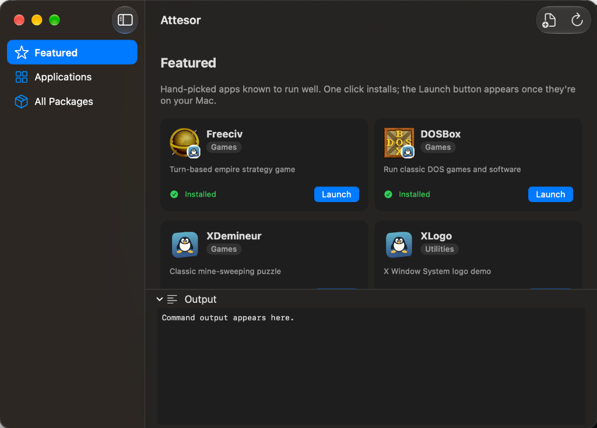
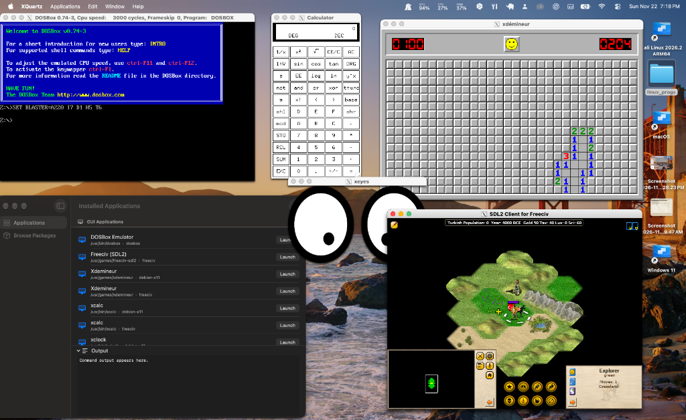

# Attesor

Attesor translates x86-64 Linux userspace programs for ARM64 Linux and Apple Silicon macOS. The maintained reconstruction runs the tested static ELF, musl-linked, and Debian glibc-linked programs. The macOS build runs directly from Terminal.

This project is a maintained continuation of [Inokinoki/attesor](https://github.com/Inokinoki/attesor), the original x86-64 → ARM64 translator research by [@Inokinoki](https://github.com/Inokinoki). This fork adds a persistent JIT fragment cache, guest threading and scheduler fairness, Debian `apt`/`dpkg` support with a writable sysroot, SDL2/X11 graphics via XQuartz, and a native macOS app for installing and launching Linux programs.

## Install on your Mac

Requires an Apple Silicon Mac. Graphical Linux apps need XQuartz.

**Homebrew (recommended)** — pulls in XQuartz automatically:

```sh
brew install --cask rbrtjns90/tap/attesor
```

**One-liner** — installs XQuartz via Homebrew, then the app from GitHub Releases:

```sh
curl -fsSL https://raw.githubusercontent.com/rbrtjns90/attesor/main/runtime-src/install.sh | bash
```

**Manual** — `brew install --cask xquartz`, then download `Attesor-<ver>.dmg` from [the latest release](https://github.com/rbrtjns90/attesor/releases/latest) and drag Attesor to Applications.

On first launch the app downloads a minimal Linux runtime (~45 MB) into `~/Library/Application Support/Attesor/` — a Debian base that fetches everything else on demand through the native package manager (downloads run on macOS, only maintainer scripts run translated). Verified working through the translator: `xterm` (real PTY + shell), `xboard` + `gnuchess`, `xsol`, `xpat2`, `xbill`, `lbreakout2`, `xgalaga` (windowed), the full `x11-apps`/`x11-utils` sets — `xlogo`, `xcalc`, `xclock`, `xeyes`, `xfontsel`, `xman`, `xload`, `xmag`, `xmessage`, `xclipboard`, `xwd`/`xwininfo`/`xdpyinfo` and friends — plus games: `xpuzzles` (all 12: `xrubik`, `xpyraminx`, `xskewb`, `xoct`, `xmball`, `xmlink`, `xcubes`, `xtriangles`, `xhexagons`, `xdino`, `xbarrel`, `xpanex`), `xdemineur`, `xmahjongg`, `xchain`, and the GTK3 `sgt-puzzles` collection (40 games); `xpdf` and `gv`+`ghostscript` for documents; editors/graphics `nedit`, `mousepad`, `xfig`, `xpaint`, `dia`, `abiword`; viewers `xzgv`, `feh`; `xfe` file manager; `filezilla` (wxWidgets); `xscreensaver-settings`; `gnumeric`, `gftp`, `geeqie`, and `mesa-utils` (`glxgears`/`glxdemo`/`glxinfo` — GLX works under XQuartz); `gimp` runs; `evince` (GTK3 PDF viewer), `xfce4-terminal`, and `htop`/`mc` work; `gedit`, `thunar`, `audacious`, and `mplayer` (audio + `-vo x11`) work; `hexchat`, `pidgin`, `transmission-gtk`, `xfce4-screenshooter`, and `deluge-gtk` (Python + PyGObject) work; `geany`, `ristretto`, `atril`, `galculator`, `xfce4-taskmanager`, and Qt5 apps `qterminal`/`featherpad` work. `libreoffice-writer` works (headless document conversion verified); `claws-mail`, `engrampa`, `gpicview`, `xfburn`, `catfish` (Python), `audacity`, `sqlitebrowser`, and SDL2 games `supertux`/`chromium-bsu` work; `keepassxc`, `zathura`, `terminator`, `pdfarranger`, `xournalpp` work. `inkscape` runs under JIT (`--version` verified; GUI start is heavy but gets past startup). `firefox-esr` and `thunderbird` run deep into startup — multi-process launch, IPC channels, freezable shared-memory maps, and SpiderMonkey's JIT all work. Known issues: dbus session bus stalls during client handshake (blocks `parole`, `pcmanfm`, xfconf-based apps); `vlc` refuses to run as uid 0; `chromium` needs namespaces + a real `/proc`. Freeciv and DOSBox also ship in the app. If Gatekeeper blocks the unsigned app, right-click → Open once.





## Build and test

On Linux or macOS with a C compiler, Make, and Python 3:

```sh
make
make test
```

The default build produces `reconstruct/oah`. Dynamic executables use an x86-64 library sysroot supplied with `--sysroot`. The [build and compatibility guide](reconstruct/README.md) documents the Alpine and Debian tests, required fixtures, and current limitations.

## Repository layout

| Path | Contents |
| --- | --- |
| [`reconstruct/`](reconstruct/README.md) | Maintained loader, translator, Linux syscall bridge, tests, and inventory tools |
| [`research/decompilation/`](research/decompilation/) | Archived RosettaLinux and daemon Ghidra exports |
| [`research/ghidra/`](research/ghidra/) | Historical scripts used to export decompiler output |
| [`legacy/translator/`](legacy/translator/) | Earlier translator rewrite, build files, test programs, and prebuilt artifacts |
| [`legacy/docs/`](legacy/docs/README.md) | Original project overview, guides, and [iteration reports](legacy/docs/iterations/) |

To reproduce the research inventory from the archived export, run `make inventory`. Historical translator commands use `legacy/translator/` as their working directory.
